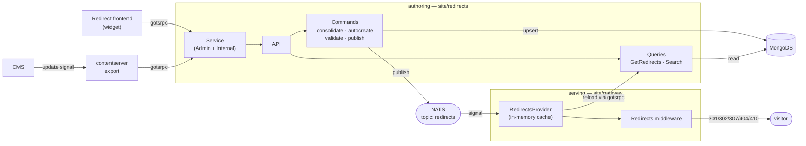
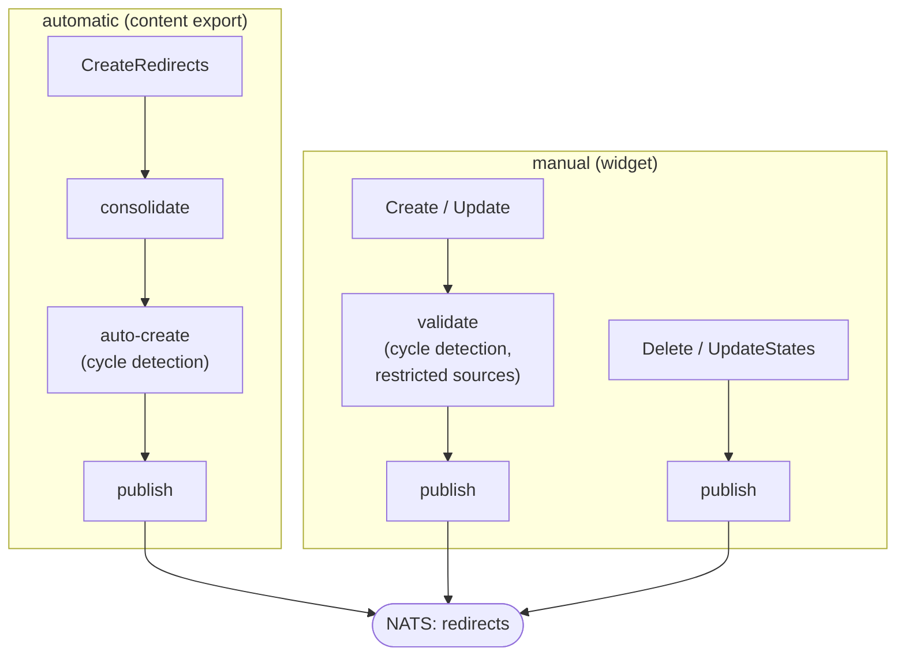
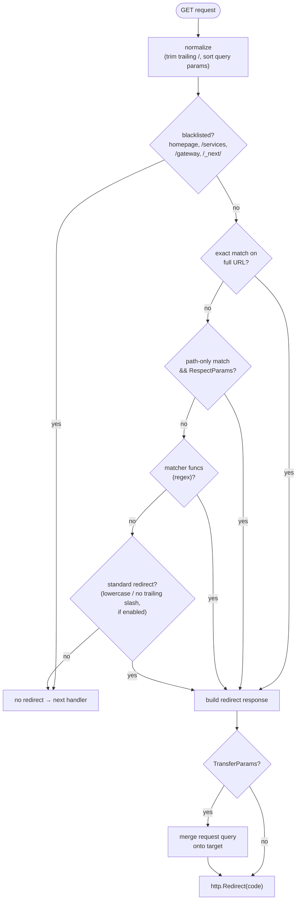

# Architecture

`redirects` is built around one load-bearing idea: **authoring redirects is
separated from serving them.** The domain service creates, validates and stores
redirect definitions; the gateway matches incoming requests and issues the HTTP
redirect; a single NATS signal is all that couples the two.

## The seam



The **authoring** side turns each create/update/delete into a validated,
persisted `RedirectDefinition` and publishes a signal. The **serving** side
holds every active definition in memory, rebuilds that cache whenever the signal
fires, and matches requests against it on the hot path. Neither side calls the
other directly — they meet at MongoDB (durable state) and NATS (change
notification).

## `RedirectDefinition`

Everything the system stores and serves is one struct:

```go
type RedirectDefinition struct {
    ID              EntityID        // stable identifier
    ContentID       string          // originating content node (automatic redirects)
    Source          RedirectSource  // path that is redirected from
    Target          RedirectTarget  // destination
    Code            RedirectCode    // 301 / 302 / 307 / 404 / 410
    RespectParams   bool            // match the source path even when the request has query params
    TransferParams  bool            // merge the request's query params onto the target
    RedirectionType RedirectionType // automatic (from content) or manual (from the widget)
    Dimension       Dimension       // "{site}-{locale}" — the matching scope
    Stale           bool            // excluded from serving (disabled or cycle-broken)
    Updated         DateTime
    LastUpdatedBy   string
}
```

`Dimension` is the scoping key: definitions are stored and matched as
`map[Dimension]map[RedirectSource]*RedirectDefinition`. The domain service builds
it as `"{site}-{locale}"` from the [site identifier
provider](../reference/configuration#withsiteidentifierprovider); the gateway
resolves the same key from the incoming request via its `DimensionProviderFunc`.

## Domain layers

Each layer lives in its own package. The import-alias convention is an `x`
suffix (`storex`, `commandx`, `queryx`, `providerx`).

| Package | Owns |
| --- | --- |
| `store/` | Storage/wire primitives: `RedirectDefinition`, `Redirect`, `RedirectSource`/`Target`/`Request`, `Dimension`, `Site`, `RedirectCode`, `PaginatedResult`, errors. |
| `repository/` | `RedirectsDefinitionRepository` interface + MongoDB implementation (`NewBaseRedirectsDefinitionRepository`). |
| `command/` | Write handlers and their middleware composers: consolidate, auto-create, validate, publish. |
| `query/` | Read handlers: `GetRedirects`, `Search`. |
| `api.go` | `*API` composes the handlers and installs middleware from the configured providers. |
| `service/` | The two gotsrpc surfaces — `AdminService` (frontend widget) and `InternalService` (backend-to-backend). |
| `pkg/nats` | `UpdateSignal` — publish/subscribe on the `redirects` topic. |
| `pkg/provider` | `RedirectsProvider` — the gateway-side cache and matching engine. |
| `pkg/middleware` | `Redirects` — the keel HTTP middleware that performs the redirect. |

## Write pipeline

Every write is a command composed with middleware, applied in order by
`NewAPI`. The last stage always publishes the NATS signal:



- **Automatic** redirects are derived from the content-server export diff,
  consolidated against existing definitions, and auto-created with cycle
  detection. Whether they start active or `Stale` is decided by
  [`WithIsAutomaticRedirectInitiallyStaleProvider`](../reference/configuration#withisautomaticredirectinitiallystaleprovider).
- **Manual** redirects from the widget pass validation (cycle detection and
  restricted sources) before being saved.

## Redirect processing

### Cycle detection

The system detects **cyclic redirects** and prevents infinite loops by marking
the affected definitions as **stale** — a stale definition stays in the
database but is excluded from serving.

Given:

- `/a → /b`
- `/b → /c`
- `/c → /a` — *cycle detected, marked as stale*

`/a` ultimately loops back to itself, so the chain is disabled.

### Flattening

**Flattening** collapses multi-step chains into a **single final target** so a
visitor is redirected exactly once.

Before:

- `/a → /b`, `/b → /c`, `/c → /d`

After:

- `/a → /d`, `/b → /d`, `/c → /d`

### Matching on the hot path

`RedirectsProvider.Process` runs on every `GET` in the gateway and resolves a
definition in this order:



`RespectParams` decides whether a source registered without query parameters
still matches a request that carries them; `TransferParams` decides whether the
request's query string is merged onto the target. Standard redirects
(lower-casing and trailing-slash removal) are opt-in via
[`WithUseStandardRedirects`](../reference/configuration#gateway-provider-options).

## Load-bearing design choices

### Serving never touches the database directly

The gateway reads definitions through the `InternalService.GetRedirects` gotsrpc
call and holds the result in memory behind an `RWMutex`. MongoDB is only ever
touched by the redirects service, so the gateway has no database credentials and
matching stays a map lookup.

### NATS is a notification, not a payload

`UpdateSignal.Publish` sends an empty message. The signal means "something
changed — reload"; the gateway responds by re-fetching the full set. There is no
partial-update protocol to keep consistent, and a missed message self-heals on
the next signal.

### Redirect problems never break the gateway

The middleware only acts on `GET`, logs and swallows any error from `Process`,
and falls through to the next handler when no definition matches. A broken or
empty redirect cache degrades to "no redirect", never to a failed request.

### Definitions are disabled, not deleted

Cycle-broken and operator-disabled definitions are marked `Stale` rather than
removed, so the history and the originating `ContentID` survive and a redirect
can be re-enabled via `UpdateStates`.

## What `redirects` does not do

- It does not run the NATS server or MongoDB — you supply both connection URIs.
- It does not ship the frontend widget; it exposes the `AdminService` the widget
  talks to over gotsrpc.
- It does not resolve the site/locale for you — you provide a
  `SiteIdentifierProvider` (authoring) and a `DimensionProviderFunc` (gateway).
- It does not, by default, apply lower-case / trailing-slash "standard"
  redirects — enable them explicitly on the gateway provider.
