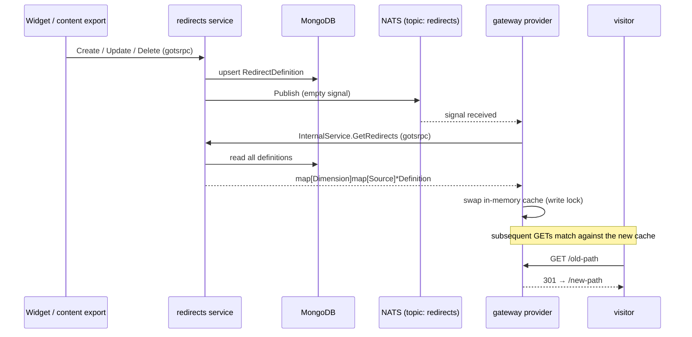

# Integration

An end-to-end runbook for wiring `redirects` into a site: the **authoring**
service (creates and stores definitions) and the **serving** gateway (matches
requests and redirects). They are coupled only through MongoDB and a NATS topic —
see [Architecture](./architecture) for the why.

## What each side needs

| Component | Needs | Provided by |
| --- | --- | --- |
| redirects service | MongoDB URI | your infrastructure |
| redirects service | NATS URI + topic | your infrastructure (default topic `redirects`) |
| redirects service | `SiteIdentifierProvider` | you — resolves the `Site` from a request |
| redirects service | admin + internal HTTP ports | mounted as gotsrpc proxies |
| contentserver export | URL of the **internal** service | to push content diffs |
| frontend widget | URL of the **admin** service | to CRUD manual redirects |
| gateway | URL of the **internal** service | to pull definitions over gotsrpc |
| gateway | NATS URI + topic | must match the service's topic |
| gateway | `DimensionProviderFunc` | you — resolves `"{site}-{locale}"` from a request |

The `Dimension` string (`"{site}-{locale}"`) is the one contract both sides must
agree on: the service stamps it onto every definition, the gateway uses it to
look definitions up.

## 1. Authoring service

Mount both gotsrpc surfaces. The **admin** service is for the frontend widget;
the **internal** service is for the content export and the gateway.

```go
api, err := redirectdefinition.NewAPI(l, repo, updateSignal,
    redirectdefinition.WithSiteIdentifierProvider(siteIdentifier),
    redirectdefinition.WithRestrictedSourcesProvider(restrictedSources),
    redirectdefinition.WithUserProvider(currentUser),
    redirectdefinition.WithIsAutomaticRedirectInitiallyStaleProvider(func() bool { return true }),
)
log.Must(l, err, "could not create redirect api")

service := redirectdefinition.NewService(l, api,
    // gate automatic redirect creation, e.g. off in maintenance windows
    redirectdefinition.WithEnabledFunc(func() bool { return true }),
)

svr.AddServices(
    keelservice.NewHTTP(l, "redirects-admin", ":8080",
        redirectservice.NewDefaultAdminServiceGoTSRPCProxy(service)),
    keelservice.NewHTTP(l, "redirects-internal", ":8081",
        redirectservice.NewDefaultInternalServiceGoTSRPCProxy(service)),
)
```

See [Configuration](../reference/configuration) for every option and its default.

## 2. Connect the content-server export

Automatic redirects are created when content changes. The content-server export
calls `CreateRedirectsFromContentserverexport` on the **internal** service with
the old and new content trees; the service diffs them, runs cycle detection and
stores the results.

```go
func (rs *Service) CreateRedirectsFromContentserverexport(
    _ http.ResponseWriter,
    r *http.Request,
    oldState, newState map[string]*content.RepoNode,
) error
```

Point your export at the internal service URL (over the generated gotsrpc
client, or by calling the endpoint directly). Creation is skipped entirely when
[`WithEnabledFunc`](../reference/configuration#withenabledfunc) returns `false`,
so you can disable automatic redirects without redeploying.

## 3. Propagation flow

Any successful write publishes an **empty** message on the NATS topic. The
message means only "reload"; the gateway responds by re-fetching the full set.



A missed signal is self-healing: the next write triggers another reload, and the
gateway loads the full set on start-up regardless.

## 4. Serving gateway

The gateway subscribes to the topic, builds a `RedirectsProvider`, starts it, and
installs the middleware. The provider's data source is the **internal** service's
generated gotsrpc client — whose `GetRedirects` signature matches
`RedirectsProviderFunc` exactly, so it can be passed directly.

```go
import (
    redirectservice "github.com/foomo/redirects/v2/domain/redirectdefinition/service"
    redirectstore "github.com/foomo/redirects/v2/domain/redirectdefinition/store"
    redirectmiddleware "github.com/foomo/redirects/v2/pkg/middleware"
    redirectnats "github.com/foomo/redirects/v2/pkg/nats"
    redirectprovider "github.com/foomo/redirects/v2/pkg/provider"
)

// 1. subscribe to change signals (topic must match the service's)
updates, err := redirectnats.NewUpdateSignalSubscribeChannel(ctx, l,
    "nats://localhost:4222", "gateway", string(redirectnats.DefaultNatsTopic()))
log.Must(l, err, "failed to subscribe to redirect updates")

// 2. data source: the internal service's gotsrpc client
client := redirectservice.NewDefaultInternalServiceGoTSRPCClient("http://redirects-internal:8081")

// 3. resolve the matching dimension from the request
dimension := func(r *http.Request) (redirectstore.Dimension, error) {
    return redirectstore.Dimension(siteAndLocale(r)), nil // "{site}-{locale}"
}

// 4. build and start the provider
provider := redirectprovider.NewProvider(l, client.GetRedirects, dimension, updates,
    redirectprovider.WithUseStandardRedirects(), // optional: lowercase / trailing-slash redirects
)
log.Must(l, provider.Start(ctx), "failed to start redirects provider")

// 5. install the middleware on the gateway's request chain
gateway.Use(redirectmiddleware.Redirects(provider))
```

`Start` loads the initial cache and launches a goroutine that reloads on every
signal. The middleware only acts on `GET`, logs and swallows any matching error,
and falls through when nothing matches — so redirects can never break the
gateway. See [request matching](./architecture#matching-on-the-hot-path) for the
resolution order and the [gateway provider
options](../reference/configuration#gateway-provider-options) for regex matchers
and standard redirects.

## Pre-flight checklist

- [ ] MongoDB reachable from the redirects service.
- [ ] NATS reachable from **both** the service and the gateway, with the **same
      topic** on each (default `redirects`).
- [ ] `SiteIdentifierProvider` (service) and `DimensionProviderFunc` (gateway)
      produce the **same** `"{site}-{locale}"` string for a given request.
- [ ] Content-server export points at the **internal** service URL.
- [ ] Frontend widget points at the **admin** service URL.
- [ ] Gateway's internal-service client URL is reachable at start-up — the
      initial `provider.Start` fetch must succeed.
- [ ] `RestrictedSourcesProvider` configured if manual redirects must be blocked
      for certain sources.
- [ ] Decide whether automatic redirects start `Stale`
      (`WithIsAutomaticRedirectInitiallyStaleProvider`) and whether standard
      redirects are enabled (`WithUseStandardRedirects`).
